# Terraforming Mars: a fast engine and an AI that learns to play


A digital version of the board game *Terraforming Mars*, built from scratch. It has a rules engine in
Rust, a browser GUI to play it in, and a ladder of AI opponents that will be trained on human games and
then by self-play, with one goal: **an AI that beats me in most 2-player Games without seeing cards it
shouldn't.**

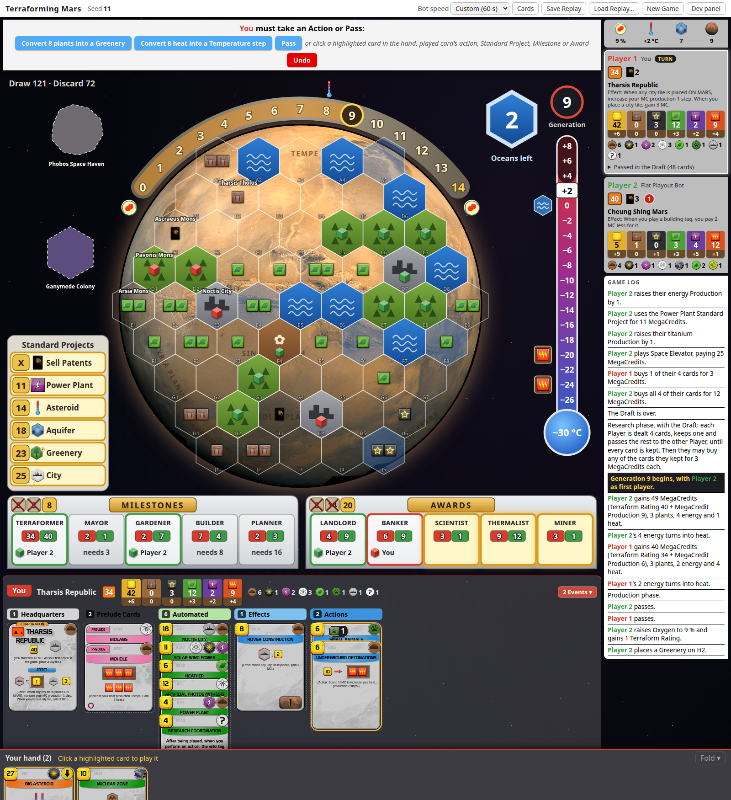

<sub>Generation 9, seen by the human Player 1 (red) against the Flat Playout Bot (green). Below the board are
Player 1's played cards and at the bottom the hand. The board, Standard Projects, Milestones, Awards and cards
light up and are clicked when a Decision offers them.</sub>

> [!TIP]
> **Like Terraforming Mars? Please support its creators and buy the game.** This is an unofficial fan
> project, built out of love for the original. Get the board game from
> [FryxGames](https://fryxgames.se/product/terraforming-mars/) or your local game store, or the official
> digital version on [Steam](https://store.steampowered.com/app/800270/Terraforming_Mars/).

---

## Contents

- [Overview](#overview)
- [Highlights](#highlights)
- [Screenshots](#screenshots)
- [Architecture](#architecture)
- [Performance](#performance)
- [The AI and its training](#the-ai-and-its-training)
- [Setup](#setup)
- [Testing and quality](#testing-and-quality)
- [Project structure](#project-structure)
- [Design decisions](#design-decisions)
- [Credits](#credits)

## Overview

*Terraforming Mars* is a strategy game for 1–5 players. Corporations compete to make Mars habitable by
raising its Temperature and Oxygen and placing Oceans, while building up an economy from about 260
unique cards. It is hard for an AI: Games are long (several hundred Decisions for 2 Players), much is hidden
(hands, the deck, the opponent's Draft), and a card's worth depends on the whole position.

The project has two phases:

| Phase | Goal | Status |
| --- | --- | --- |
| **1. A playable game** | A correct, fast and well-tested engine with a GUI, all 208 Project Cards and 12 Corporations | ✅ Done |
| **2. An AI opponent** | Prelude expansion, fair Controllers, then a ladder of ever stronger AIs trained on human games and self-play | 🚧 In progress: tickets 01–10 of 17 done |

The engine covers the full base game on the Tharsis board with Corporate Era, the Draft, and the
**Prelude** expansion: 2–5 Players and **all 267 cards** (208 Project Cards, 12 Corporations, and Prelude's 35
Prelude Cards, 5 Corporations and 7 Project Cards). Players are humans in the GUI (one, or several in Hotseat)
or AI Controllers.

## Highlights

- **A fast rules engine in Rust.** About 54,000 complete Games per second on a laptop, and a full copy of
  a Game in under 1 µs. That is fast enough for self-play training and for search at play time
  ([Performance](#performance)).
- **Every input is a Decision with Options.** The engine never asks for free-form input: every choice a
  Player makes, from playing a card to paying with steel or placing a Tile, is one Option picked from a
  list (ADR 0002). Humans, bots and neural networks all play through this one interface.
- **Fair play by construction.** An AI Controller gets only its Player's view, never the Game. To look
  ahead, it asks for *Sampled Positions*: Games in which the cards it can't see are dealt at random,
  consistent with what it knows. Tests check that a hidden card never changes a Sampled Position.
- **Reproducible down to the pick.** Every Game comes from a seed and is stored as a Replay (its start
  and the index of each Option picked). Any Game, bug or Match can be loaded again at any step.
- **Tested heavily.** 2,111 tests, scenario tests that read like play, a scenario test for every card,
  and a fuzzer that plays 100,000 random Games and checks rule invariants after every Decision.
- **A game you can actually play.** A browser GUI laid out like Board Game Arena's, with Undo, Save and
  Load Replay, a card gallery, and a dev panel for hunting rule bugs.
- **Learning from about 59,000 human Games.** An importer turns a 147 GB archive of Board Game Arena logs
  into a compact training set. It rebuilds each Player's hand move by move, and its hand sizes match Board
  Game Arena's own counter 99.2% of the time. Replayed through the engine, 73% of those Games play out
  exactly as logged, which also tests the rules against real play.

## Screenshots

| Card gallery | Dev panel |
| --- | --- |
| 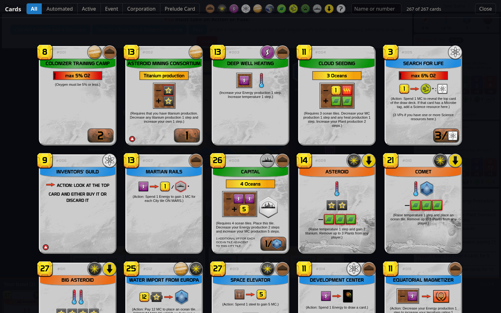 | 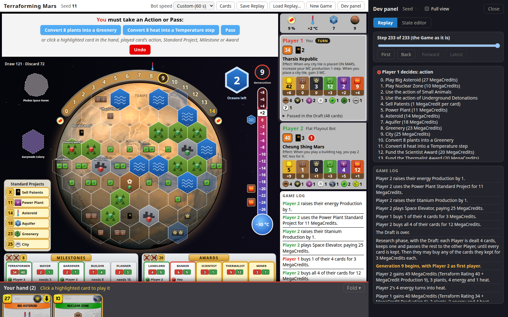 |
| All 267 cards, filtered by type, Tag, name or number. | Step back through every pick and see the Options each Decision offered. A state editor can start a Game from any position. |

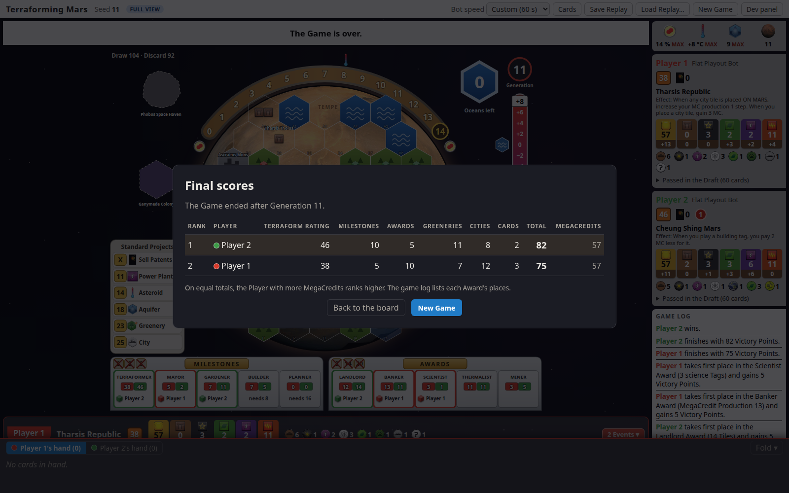

<sub>The end of a Game between two Flat Playout Bots, in the full view that shows both hands.</sub>

## Architecture

The engine is a Rust library with Python bindings ([PyO3](https://pyo3.rs) and maturin). Everything else
(tests, the server, the AI, the tools) goes through the Python module `tm_engine`; nothing else reaches into
the engine.

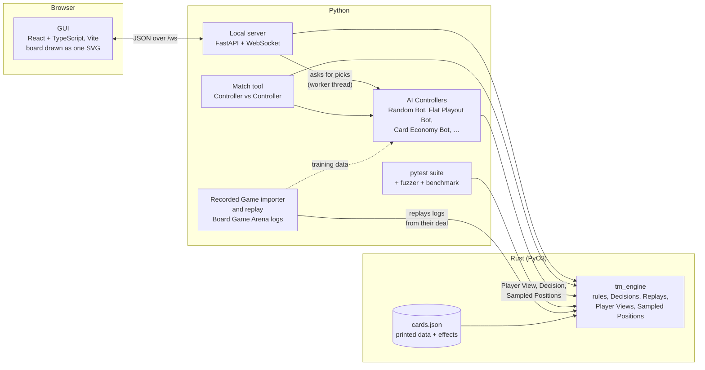

### How a Game flows

A Game is a series of phases. Each one waits on Decisions from one or more Players, and the engine moves on
by itself once nobody has a choice to make.

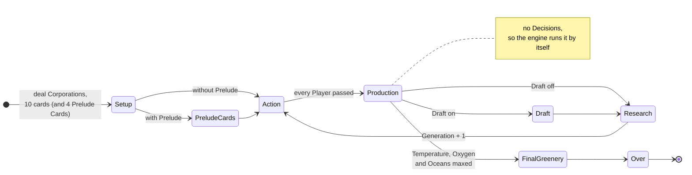

### The engine's domain model

The core types in `engine/src/` (simplified). A `Game` is plain data that copies cheaply, which is what
makes search and Sampled Positions affordable.

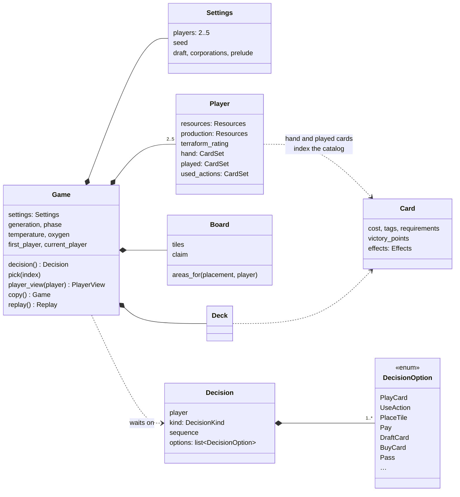

### The Controller seam: fair play

Every non-human Player is a **Controller**: anything with a `pick(handle) -> int` method. The handle holds
plain data only: the Player's view, the Decision, a random source, and a `Sampler` that makes Sampled
Positions inside the engine. No Controller imports the engine, and a test checks that.

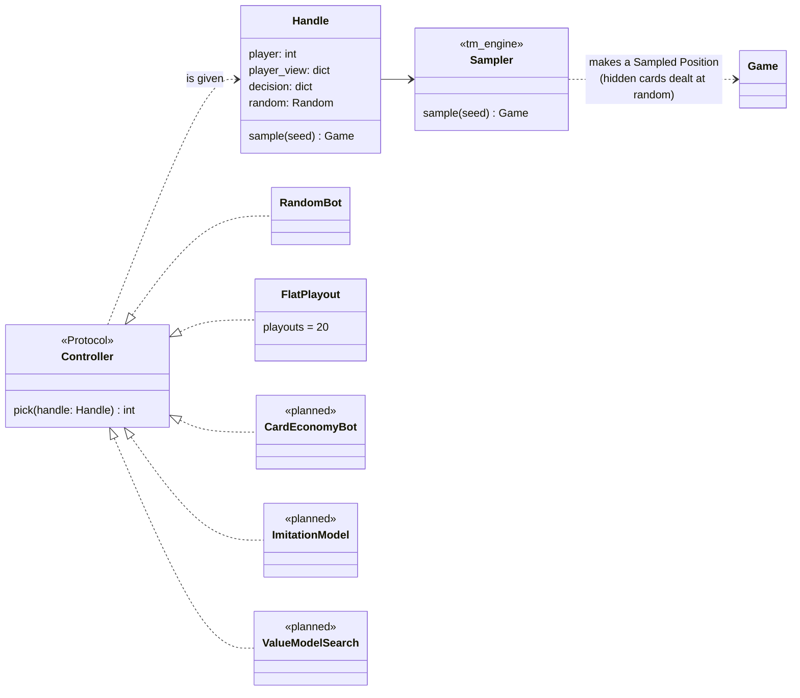

### One Turn in the GUI

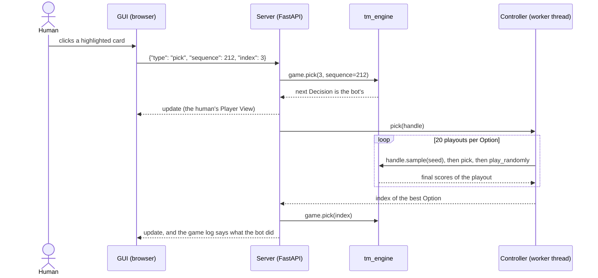

## Performance

### Engine speed

ADR 0004 set the bar: at least **1,000 complete 2-player Games per second**, and copying a Game in
microseconds, because self-play needs millions of Games on a laptop. A pure-Python engine was estimated at
200–400 Games per second.

| Measure (2 Players, Draft, Random Bots) | Without Prelude | With Prelude | Target |
| --- | ---: | ---: | ---: |
| Complete Games per second, 16 processes | **53,507** | **55,870** | 1,000 |
| Complete Games per second, 1 process | 5,553 | 6,031 | |
| Copy a Game (start / halfway / end) | 0.20 / 0.61 / 0.88 µs | 0.22 / 0.45 / 0.71 µs | < 10 µs |
| Make a Sampled Position (start / halfway / end) | 1.6 / 2.9 / 2.1 µs | 2.0 / 2.3 / 3.0 µs | < 10 µs |
| Decisions per second through a Python loop | 280,794 | 248,110 | |
| Encode a position and its Options (start / halfway / near the end), for information | 164 / 166 / 204 µs | 161 / 224 / 118 µs | |
| Mean Generations of a Random Bot Game | 20.99 | 17.87 | |

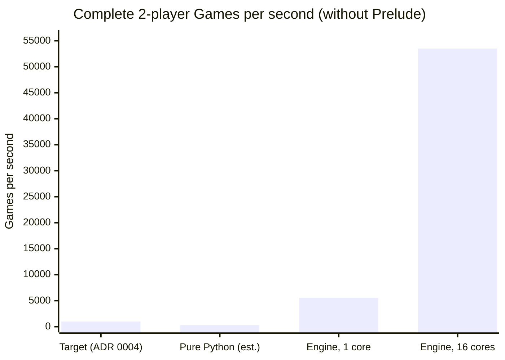

<sub>Encoding (ticket 12 of phase 2) measured on 2026-11-17; a Player View takes 32–49 µs at the same moments.
Measured on 2026-11-16 with `uv run python -m tools.benchmark` (`--prelude` for the second column) on a
laptop with an AMD Ryzen 7 8845HS (8 cores, 16 threads), on mains power, "performance" profile.</sub>

### Bots so far

A **Match** (ADR 0013) plays two Controllers against each other on all cores: N Games on N/2 seeds, each
seed played both ways, so that neither side gets the luckier deal. It reports win rates with a 95%
interval.

| Match (2 Players, Draft, Prelude) | Games | Win rate (95% interval) | Mean Victory Points | Card VP | Terraform Rating | Generations |
| --- | ---: | --- | --- | --- | --- | ---: |
| Random Bot vs Random Bot (sanity check) | 1,000 | 51.6% (48.6–54.7%) | 78.5 – 77.2 | 5.2 – 5.3 | 43.2 – 42.8 | 17.9 |
| **Flat Playout Bot vs Random Bot** | 200 | **100%** (98.1–100%) | **126.6 – 53.9** | 12.2 – 4.0 | 50.5 – 37.0 | 16.2 |
| **Card Economy Bot vs Random Bot** | 400 | **100%** (99.0–100%) | **157.9 – 49.3** | 26.9 – 3.8 | 56.3 – 35.7 | 15.1 |
| **Card Economy Bot vs Flat Playout Bot** | 1,000 | **96.4%** (95.0–97.3%) | **114.0 – 74.6** | 18.4 – 5.8 | 45.6 – 44.5 | 13.3 |
| Card Economy Bot vs Flat Playout Bot at 1,000 playouts per Option | 100 | 29.5% (21.5–39.1%) | 93.0 – 103.7 | 16.8 – 13.3 | 40.6 – 48.9 | 12.8 |
| Card Economy Bot vs itself | 1,000 | 49.9% (46.8–53.0%) | 117.6 – 97.5 (winner – loser) | 20.1 (winner) | 46.7 | 13.6 |
| **Imitation Bot vs Card Economy Bot** | 600 | **89.7%** (87.0–91.9%) | **130.8 – 96.8** | 37.8 – 15.9 | 48.4 – 44.3 | 13.3 |
| *For reference: human Games on Board Game Arena* | 51,422 | | 106 – 87 (winner – loser) | 28 (better Player) | | 10.7 |

The **Flat Playout Bot** plays each Option out to the end of the Game at random on 20 Sampled Positions and
picks the best mean Victory Point margin. It needs about 14 ms per pick. It already crushes random play, but
human Games end in about 11 Generations, against its 16, and humans score about 28 card Victory Points
against its 12. That gap is what the training below is meant to close.

The **Card Economy Bot** prices every Option in MegaCredits: Production by the Generations left, Victory
Points rising towards what Standard Projects charge for them, cards in hand, Tags, Tiles, Milestones and
Awards. It tries each Option one step ahead on a single Sampled Position and picks the best change in its
worth less the other Player's. It needs about 3 ms per pick (31 ms at most). Its weights were fitted by
Matches against itself with a CMA-ES, and it can explain any pick in the dev panel's Bot tab or with
`uv run python -m ai.explain`. Against itself its Games still run 13.6 Generations, and its winners score
20 card Victory Points against humans' 28. It can't use more time, though. Given 1,000 playouts per Option
(0.7 s per pick), the Flat Playout Bot beats it in 70% of Games. Making good use of time is the job of
search at play time (ticket 16).

The **Imitation Bot** chooses its Corporation and Prelude Cards, drafts and buys cards as the **Imitation Model**
predicts strong Players would, and plays everything else as the Card Economy Bot does. The model is a small
transformer over the cards a Player can see and the Options, trained on human Games (see below). On held-out Games
it picks what the Player picked 72% of the time (75% for Players rated 600+), against 54% for always taking the
most-kept card and 39% for the Card Economy Bot's Prices. Those picks alone lift the Card Economy Bot from 16 to 38
card Victory Points a Game, more than humans' 28, and win 90% of Games against it.

<sub>Measured on 2026-11-16 with `uv run python -m ai.match random_bot random_bot --games 1000` and
`uv run python -m ai.match flat_playout random_bot --games 200`, and on 2026-11-17 with
`uv run python -m ai.match card_economy random_bot --games 400`,
`uv run python -m ai.match card_economy flat_playout --games 1000 --first-seed 1000` and
`uv run python -m ai.match card_economy card_economy --games 1000`, and with
`uv run python -m ai.match imitation card_economy --games 600 --processes 8` (2026-11-19); the Match at 1,000 playouts by a script
recorded in ticket 11's Comments. The human figures come from the Recorded Game
archive (2 Players, Tharsis, Corporate Era, Draft and Prelude) and are not a Match against these bots.</sub>

## The AI and its training

The AI is built as a **ladder of Controllers** (ADR 0013). Each rung is playable on its own, and each must
win a Match against the rung below before it counts. If a later step fails, the earlier ones still work.

```mermaid
flowchart LR
    R["Random Bot"]:::done --> F["Flat Playout Bot<br/>random playouts on<br/>Sampled Positions"]:::done
    F --> C["Card Economy Bot<br/>Options by fitted Prices"]:::done
    C --> I["Imitation Model<br/>Draft and buying<br/>from human Games<br/>(ticket 13)"]:::done
    I --> I2["Imitation Model<br/>every Decision<br/>(ticket 14)"]:::todo
    I2 --> V["Value Model<br/>improves by self-play<br/>(ticket 15)"]:::todo
    V --> S["Search at play time<br/>tree over Sampled Positions<br/>(ticket 16)"]:::todo
    S --> H(["Beats me in<br/>most Games<br/>(ticket 17)"]):::goal
    classDef done fill:#2ea44f,color:#fff,stroke:#22863a
    classDef todo fill:#f6f8fa,stroke:#8b949e,stroke-dasharray: 5 5
    classDef goal fill:#d73a49,color:#fff,stroke:#b31d28
```

Two rules hold on every rung:

- **No Controller sees hidden cards, not even in lookahead.** Trying an Option on a copy of the real Game
  would leak the next card drawn, so every lookahead uses a Sampled Position instead.
- **Strategy knowledge goes in as model inputs and as a training start, never as fixed rules.** A model is
  given facts such as payback time or distance to a Requirement and is free to overrule them. A hand-written
  rule would cap its strength wherever the rule is wrong.

### Training progress

Each rung is measured the same way when it is finished: a Match against the rung below it and one against the
Flat Playout Bot, 2 Players with Draft and Prelude. Mean Victory Points and Generations are from the Match
against the rung below. This table is updated as the ladder is climbed.

| Rung | Status | Win rate vs the rung below | Win rate vs Flat Playout Bot | Mean VP | Generations | Time per pick |
| --- | --- | --- | --- | ---: | ---: | ---: |
| Random Bot | ✅ | 51.6% vs itself | 0% | 78.5 | 17.9 | negligible |
| Flat Playout Bot | ✅ | 100% (98.1–100%) | — | 126.6 | 16.2 | about 14 ms |
| Card Economy Bot | ✅ | 96.4% (95.0–97.3%) | the same Match | 114.0 | 13.3 | about 3 ms |
| Imitation Bot: Imitation Model for setup, Draft and buying | ✅ | 89.7% (87.0–91.9%) | not measured | 130.8 | 13.3 | about 5 ms |
| Imitation Model, every Decision | ⏳ ticket 14 | | | | | |
| Value Model, after self-play | ⏳ ticket 15 | | | | | |
| Search at play time | ⏳ ticket 16 | | | | | |
| **Against me in the GUI** | ⏳ ticket 17 | goal: win most of a fixed set of seeded Games | | | | |

### The training data

The Imitation Model learns from **Recorded Games**: about 292,000 Board Game Arena logs from
[tfmstats.com](https://tfmstats.com)'s archive (147 GB). The importer keeps the 2-player Tharsis Games with
Corporate Era and the Draft, about 59,000 of them, and writes each Player's setup, Draft and buy Decisions
with only what that Player could see. That takes about 9 minutes on all cores and gives a dataset of about
1 GB. Player names are dropped and ids are salted hashes. The logs name no licence, so the archive, the
dataset and anything trained on them stay private and out of this repository.

Each Game whose log names both Players' cards is then replayed through the engine
(`uv run python -m ai.recorded_games.replay_dataset`, about 10 minutes on all cores). The engine starts from the
deal the log shows, answers every Decision from the log, and compares its trackers with the log's after each Action,
stopping a Game at its first difference. 73% of the 44,714 Games replay to the end; the rest give the Decisions
before their first difference. That adds about 16 million engine Decisions, about 10 million of them in the Action
phases, each with the engine's own Options and Player View for imitation.

| Recorded Games (2 Players, Tharsis, Corporate Era, Draft) | With Prelude | Without Prelude |
| --- | ---: | ---: |
| All Games | 51,422 | 7,622 |
| Not conceded | 32,125 | 5,865 |
| Both Players rated 600+ | about 1,400 | 42 |
| Mean Generations | 10.7 | 12.4 |
| Mean Victory Points, winner – loser | 106 – 87 | 105 – 82 |

## Setup

You need [Rust](https://rustup.rs), [uv](https://docs.astral.sh/uv/) (which installs Python 3.14) and
Node.js 22. Then, in the project folder:

```bash
uv sync
```

```bash
npm --prefix gui install
```

`uv sync` creates `.venv` and builds the engine. After that, `uv run` rebuilds the engine by itself whenever
a Rust file changes, so there is no separate build step.

### Play

Start the server in one terminal:

```bash
uv run python -m server
```

and the GUI in another:

```bash
npm --prefix gui run dev
```

Then open http://localhost:5173, choose the number of Players and who plays each one (Human, Random Bot or
Flat Playout Bot), and start a Game. The [developer guide](docs/guide.md#play) explains the screen, the
hand, payment and the dev panel.

### Measure

```bash
uv run pytest
```

```bash
uv run python -m tools.benchmark
```

```bash
uv run python -m ai.match flat_playout random_bot --games 200
```

```bash
uv run python -m tests.fuzzing
```

The last one is the full fuzz run: 100,000 Games on all cores, about 48 minutes. The
[developer guide](docs/guide.md) covers every tool: the fuzzer, the benchmark, Matches, the card import
and coverage reports, and the Recorded Game importer.

## Testing and quality

Correctness comes first: a bot trained on a buggy engine learns the bugs.

- **2,111 tests** (`uv run pytest`): scenario tests of the rules that read like play
  (`scenario(...)`, `pick(game, "Play Mine")`), tests of the engine module, the server's WebSocket, fair
  play and the importer.
- **A scenario test for every card.** Each card has its own test file, `tests/cards/test_<id>.py`, and the
  coverage check fails the suite if an implemented card has none.
- **Fuzzing.** The suite plays about 1,000 random Games with 2–5 Players and checks invariants after every
  Decision, such as no negative Resource, no Tile where the rules forbid one, and no Area Decision offering the
  wrong Areas. The full run plays 100,000 Games and also checks that Sampled Positions are fair. Every failure
  is saved as a Replay that the GUI opens at the moment it went wrong.
- **Checked against other sources.** The card data is compared with the open-source implementation's
  definitions (`docs/card-mismatches.md`), and every rules judgment call is written down in
  [`docs/rules-notes.md`](docs/rules-notes.md), in order of authority: the rulebook, then FryxGames' FAQ,
  then the open-source game.
- **One vocabulary.** [`CONTEXT.md`](CONTEXT.md) defines the domain terms (Decision, Option, Controller,
  Sampled Position, Replay, …), and the code, tests and messages all use them.
- **Linting:** `cargo clippy --manifest-path engine/Cargo.toml` and `npm --prefix gui run typecheck`.

| | Lines |
| --- | ---: |
| Rust engine (`engine/src`) | about 9,600 |
| Python server, AI and tools | about 4,300 |
| TypeScript GUI (`gui/src`) | about 4,900 |
| Tests | about 27,800 |

## Project structure

```
engine/        Rust rules engine and its Python bindings (tm_engine)
  src/game.rs    Game state, phases, Decisions and Options
  src/board.rs   the Tharsis board, Areas and where each Tile may go
  src/cards.rs   the card catalog and each card's effect data
  cards/cards.json  printed card data + effects for all 267 cards
server/        local FastAPI server: one WebSocket, Controllers in a worker thread
gui/           React + TypeScript GUI (Vite); the board is one SVG
ai/            Controllers, the Match tool, the Recorded Game importer, and the Imitation Model (ai/imitation)
tests/         rules, cards, engine, server, AI and fuzzing tests
tools/         speed benchmark, card import, coverage and mismatch reports
docs/          ADRs, rules notes, card mismatches, the developer guide
.scratch/      specs and tickets for each phase
```

The [developer guide](docs/guide.md#where-things-are) has a file-by-file table.

## Design decisions

Each significant decision is an Architecture Decision Record in [`docs/adr/`](docs/adr/):

| ADR | Decision |
| --- | --- |
| [0001](docs/adr/0001-own-engine-not-a-fork.md) | Write our own engine instead of forking the open-source game: it is built for speed and cheap copies |
| [0002](docs/adr/0002-player-input-as-decisions.md) | All player input is a Decision with a list of Options |
| [0003](docs/adr/0003-v1-scope.md) | The scope of version 1 |
| [0004](docs/adr/0004-engine-speed-requirement.md) | 1,000 Games per second and copies in microseconds |
| [0005](docs/adr/0005-card-data-from-card-list-page.md) | Printed card data comes from the fan-made card list |
| [0006](docs/adr/0006-browser-gui-modelled-on-bga.md) | A browser GUI modelled on Board Game Arena's |
| [0007](docs/adr/0007-rust-engine-python-bindings.md) | A Rust engine with Python bindings |
| [0008](docs/adr/0008-gui-through-python-server.md) | The GUI talks to the engine through a Python server |
| [0009](docs/adr/0009-card-effects-data-plus-code.md) | Card effects are data, with code for the unusual ones |
| [0010](docs/adr/0010-games-reproducible-from-replay.md) | Every Game can be rebuilt from its Replay |
| [0011](docs/adr/0011-prelude-before-training.md) | Add Prelude before training, as most human Games use it |
| [0012](docs/adr/0012-learn-from-recorded-games-first.md) | Learn from Recorded Games before self-play |
| [0013](docs/adr/0013-a-ladder-of-controllers.md) | Build the AI as a ladder of Controllers |

## Credits

- The card faces copy the fan-made Terraforming Mars card list by ssimeonoff
  ([github.com/ssimeonoff/ssimeonoff.github.io](https://github.com/ssimeonoff/ssimeonoff.github.io),
  BSD-3-Clause): its layout, stylesheet and icons. Its title font, Prototype, is free for personal use.
- The globe is "Mars Valles Marineris", a Viking 1 Orbiter mosaic by NASA/USGS (JPL PIA04304), public
  domain, from [Wikimedia Commons](https://commons.wikimedia.org/wiki/File:Mars_Valles_Marineris.jpeg).
- Human game logs come from [tfmstats.com](https://tfmstats.com)'s archive of Board Game Arena Games. They are
  used privately for training and are not redistributed.
- The open-source [terraforming-mars/terraforming-mars](https://github.com/terraforming-mars/terraforming-mars)
  game is a reference for unclear rules and a cross-check of the card data. No code is copied from it.

*Terraforming Mars* is a game by FryxGames. This is an unofficial, non-commercial fan project, not affiliated
with or endorsed by FryxGames. If you enjoy it, please support FryxGames by
[buying the game](https://fryxgames.se/product/terraforming-mars/).
